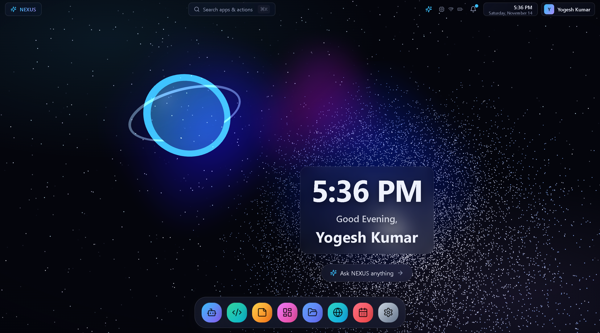
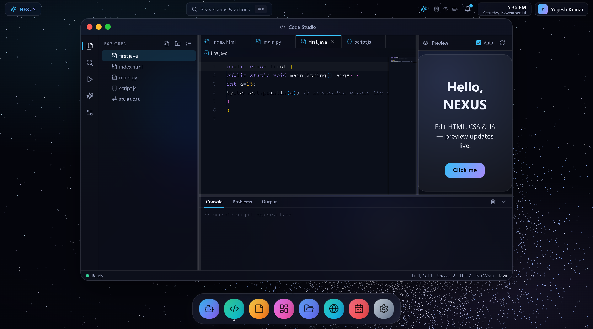
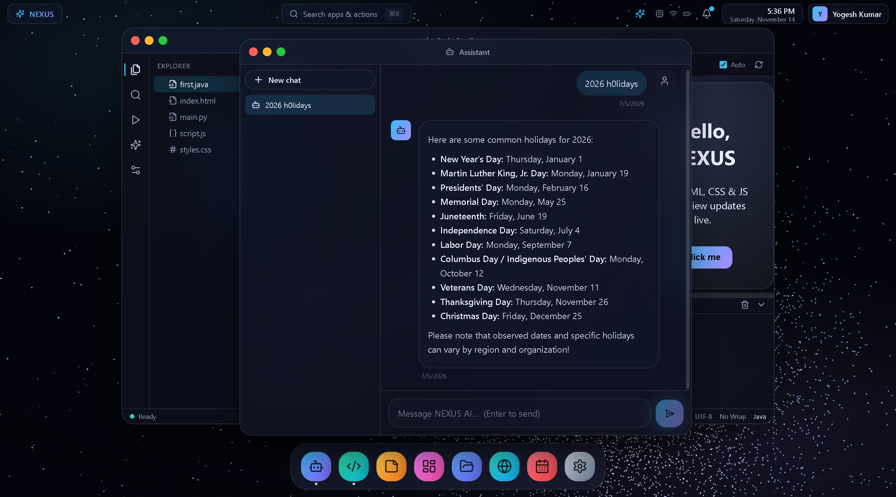
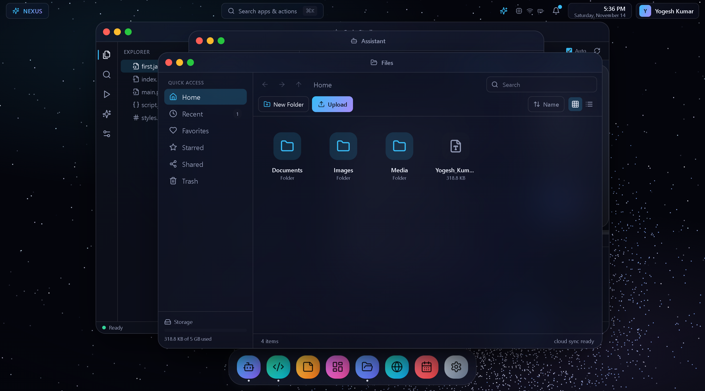
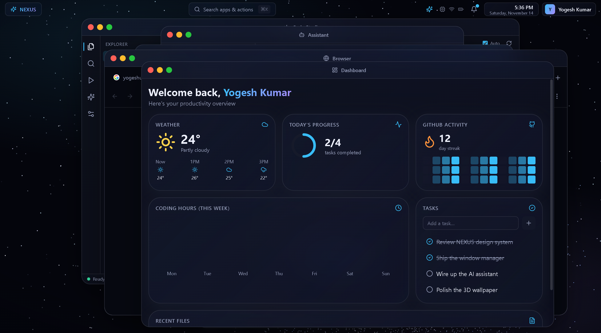
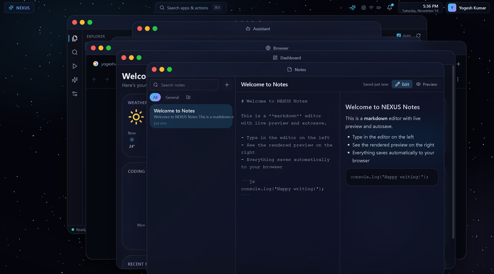
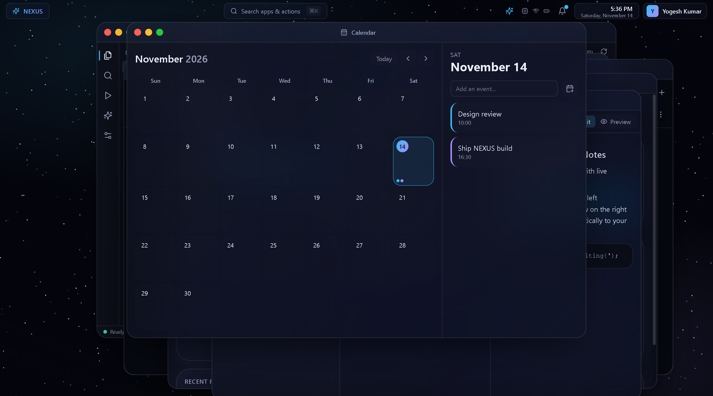
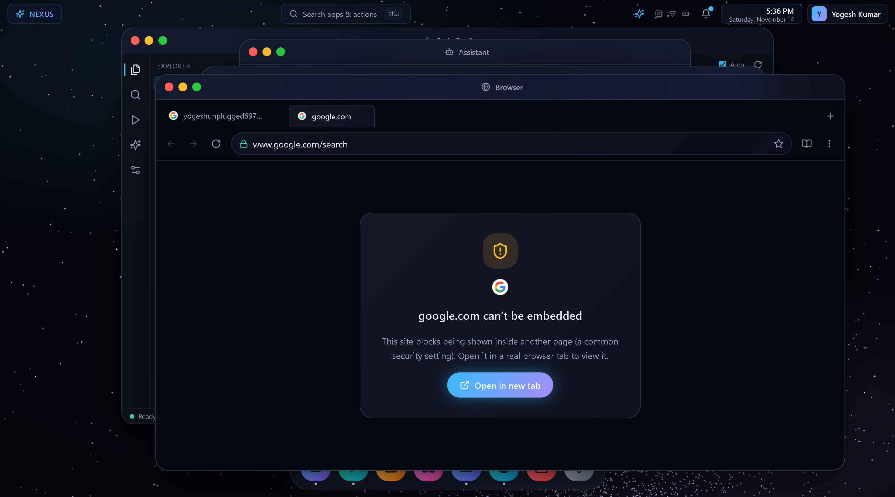
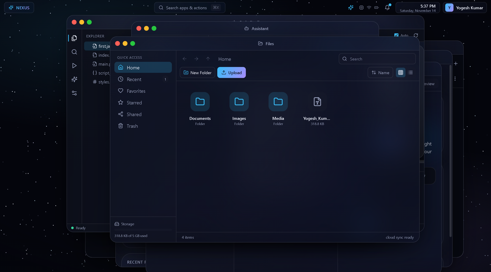
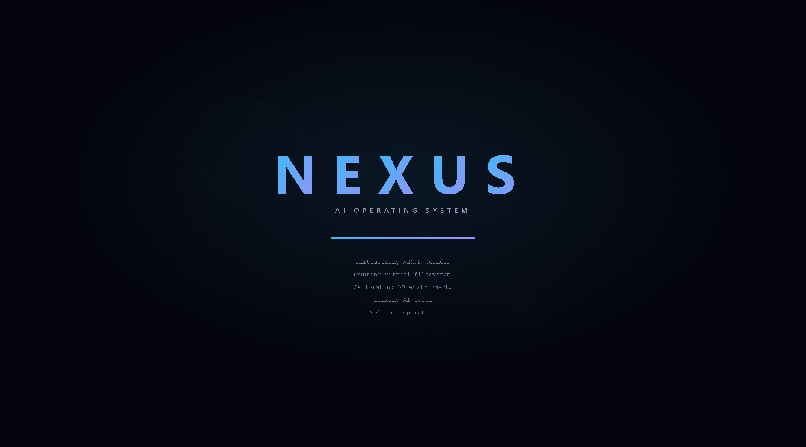

<div align="center">

# 🪐 NEXUS OS

### *The Futuristic AI-Powered Desktop Operating System for Web & Desktop*

A high-performance desktop operating system simulation crafted with modern web technologies, featuring a full window manager, an interactive 3D WebGL space environment, native Chromium web browsing, and a suite of built-in desktop applications.

[](https://nextjs.org/)
[](https://www.electronjs.org/)
[](https://www.typescriptlang.org/)
[](https://tailwindcss.com/)
[](https://threejs.org/)
[](LICENSE)

<br/>



</div>

---

## 📑 Table of Contents

- [Overview](#-overview)
- [Key Features](#-key-features)
- [Application Suite (Screenshots)](#-application-suite)
  - [Code Studio (IDE)](#1-code-studio-ide)
  - [AI Assistant](#2-ai-assistant)
  - [Advanced File Manager](#3-advanced-file-manager)
  - [Productivity Dashboard](#4-productivity-dashboard)
  - [Notes & Markdown Editor](#5-notes--markdown-editor)
  - [Calendar & Planner](#6-calendar--planner)
  - [Web Browser](#7-web-browser)
  - [Multitasking & Window Management](#8-multitasking--window-management)
  - [Cinematic Boot Sequence](#9-cinematic-boot-sequence)
- [Tech Stack](#-tech-stack)
- [System Architecture](#-system-architecture)
- [Keyboard Shortcuts](#-keyboard-shortcuts)
- [Getting Started](#-getting-started)
  - [Prerequisites](#prerequisites)
  - [Installation](#installation)
  - [Running as Web Application](#running-as-web-application)
  - [Running as Native Desktop Application (Electron)](#running-as-native-desktop-application-electron)
- [Environment Configuration](#-environment-configuration)
- [License](#-license)

---

## 🌟 Overview

**Nexus OS** bridges the gap between web capabilities and native desktop operating systems. Inspired by visionOS, Nothing OS, and futuristic HUD interfaces, Nexus delivers a desktop computing experience directly inside the browser or packaged as a standalone desktop app via Electron.

Every window can be moved, resized, maximized, minimized, or snapped to grid edges. The desktop sits on top of an interactive, GPU-accelerated 3D cosmic environment rendered with Three.js, complete with orbital mechanics, glowing nebulas, starfields, and ambient particle clouds.

---

## ✨ Key Features

- 🪟 **Real Window Manager:**
  - Draggable, resizable windows with momentum and boundary clamping.
  - Window snapping system (`SnapZone` left, right, maximize, top-left/right).
  - Stacking context and dynamic z-index focusing.
  - Window minimize to dock and maximize with geometry restoration.
- 🌌 **3D Space Engine (Three.js & React Three Fiber):**
  - Orbiting planet with luminous rings, procedural starfields, and particle simulations.
  - Interactive mouse-reactive camera parallax with bloom and tone-mapping post-processing.
  - Performance scaling adapts particle density to hardware capabilities.
- 🎨 **Glassmorphism Design System:**
  - Ultra-refined frosted glass panels (`backdrop-filter: blur()`).
  - Customizable system neon accent presets (Sky, Emerald, Amber, Fuchsia, Rose, Slate).
  - High contrast typography and fluid micro-interactions with Framer Motion and GSAP.
- 🔍 **Command Palette (`⌘K` / `Ctrl+K`):**
  - Spotlight/Raycast-style unified search to quickly launch applications, switch windows, and execute actions.
- 🚢 **macOS-Style Magnifying Dock:**
  - Spring-physics magnifying dock icons with active running process indicators.
- 🛡️ **Hybrid Web & Desktop Architecture:**
  - Runs 100% offline out-of-the-box using local persistence (`localStorage`).
  - Optional cloud synchronization with Firebase Auth and MongoDB Atlas backend.
  - Native Chromium browsing with Electron `WebContentsView` (safe context isolation, zero iframe restrictions).

---

## 📱 Application Suite

### 1. Code Studio (IDE)
A full-fledged developer environment built right into the OS. Features Monaco Editor (powering VS Code), file tree navigation, tabbed file management, real-time live HTML/CSS/JS preview, integrated console output, and in-browser Python execution via Pyodide.

<div align="center">
  
</div>

---

### 2. AI Assistant
Your desktop AI copilot powered by Google Gemini (with an offline simulated fallback). Features conversational memory, multi-chat history, rich Markdown rendering, syntax-highlighted code blocks, and copy-to-clipboard utilities.

<div align="center">
  
</div>

---

### 3. Advanced File Manager
Virtual hierarchical file system supporting folder creation, nested navigation, file inspection, drag-and-drop uploads, storage usage visualization, and trash/restore lifecycle management.

<div align="center">
  
</div>

---

### 4. Productivity Dashboard
Centralized telemetry widget board displaying live weather data, daily productivity metrics, GitHub contribution streak heatmaps, coding hours breakdown, and quick checklist management.

<div align="center">
  
</div>

---

### 5. Notes & Markdown Editor
Clean, distraction-free markdown note-taking suite with folder categorization, instant search, split-pane live Markdown preview, and seamless autosave.

<div align="center">
  
</div>

---

### 6. Calendar & Planner
Interactive monthly grid with an integrated daily agenda planner, event scheduling, and reminder tracking.

<div align="center">
  
</div>

---

### 7. Web Browser
Tabbed web browser with bookmarks, navigation history, and address bar search. In the desktop Electron shell, it runs on native Chromium (`WebContentsView`), allowing full web access without `X-Frame-Options` limitations.

<div align="center">
  
</div>

---

### 8. Multitasking & Window Management
True desktop multitasking: snap windows side-by-side, toggle between running applications, or minimize them to the dynamic dock.

<div align="center">
  
</div>

---

### 9. Cinematic Boot Sequence
Futuristic GSAP-powered boot sequence displaying kernel initialization status lines and smooth transitions into the desktop environment.

<div align="center">
  
</div>

---

## 🛠️ Tech Stack

| Layer | Technologies |
| :--- | :--- |
| **Frontend Framework** | [Next.js 14](https://nextjs.org/) (App Router, Server Components, Route Handlers) |
| **Language** | [TypeScript](https://www.typescriptlang.org/) (Strict mode) |
| **Desktop Shell** | [Electron 31](https://www.electronjs.org/) + `electron-builder` |
| **3D Graphics & WebGL** | [Three.js](https://threejs.org/), [React Three Fiber](https://r3f.docs.pmnd.rs/), [@react-three/drei](https://github.com/pmndrs/drei) |
| **Styling & UI** | [Tailwind CSS](https://tailwindcss.com/), Radix UI primitives, Lucide Icons |
| **Animations** | [Framer Motion](https://www.framer.com/motion/), [GSAP](https://gsap.com/) (GreenSock) |
| **State Management** | [Zustand](https://zustand-demo.pmnd.rs/) with `persist` middleware |
| **Code Editor** | [@monaco-editor/react](https://github.com/suren-atoyan/monaco-react) |
| **AI Integration** | [Google Generative AI](https://ai.google.dev/) (Gemini Flash/Pro SDK) |
| **Database & Auth** | [MongoDB Atlas](https://www.mongodb.com/atlas), [Firebase Auth](https://firebase.google.com/products/auth), Firebase Admin |

---

## 🏗️ System Architecture

```
nexus-os/
├── docs/
│   └── screenshots/         # High-resolution screenshots used in documentation
├── electron/
│   ├── main/
│   │   ├── index.js         # Electron lifecycle, browser window initialization
│   │   ├── next-server.js   # Spawns / attaches to Next.js production server
│   │   ├── browser-views.js # Native WebContentsView-per-tab Chromium engine
│   │   ├── permissions.js   # Media, clipboard & notification security handlers
│   │   └── downloads.js     # Native download manager controls
│   ├── ipc/
│   │   ├── channels.js      # Whitelisted IPC channel registry
│   │   └── handlers.js      # IPC handlers (secure boundary)
│   └── preload/
│       └── index.js         # Context isolation bridge (`window.nexusBrowser`)
├── src/
│   ├── app/                 # Next.js App Router & API routes
│   │   ├── api/             # REST endpoints (auth, files, notes, chats, events)
│   │   └── page.tsx         # Top-level OS mount
│   ├── components/
│   │   ├── auth/            # Glassmorphic auth modals & user profile badges
│   │   ├── shell/           # Desktop, Taskbar, Dock, Command Palette, BootScreen
│   │   ├── ui/              # Radix + Tailwind glassmorphic UI primitives
│   │   └── window/          # Window Manager, Window frame, Snap overlay
│   ├── constants/           # App registry (`APP_REGISTRY`), Dock configuration
│   ├── features/            # Standalone feature modules
│   │   ├── ai-assistant/    # Gemini AI chat interface
│   │   ├── browser/         # Dual-engine browser (Electron view + iframe fallback)
│   │   ├── calendar/        # Monthly scheduler and agenda
│   │   ├── code-studio/     # Monaco IDE, Live Preview, and runner
│   │   ├── dashboard/       # Metrics, GitHub stats, and widgets
│   │   ├── file-manager/    # Virtual filesystem & explorer
│   │   ├── notes/           # Markdown note editor
│   │   └── settings/        # Themes, accents, wallpapers, account sync
│   ├── store/               # Zustand global state slices
│   ├── three/               # React Three Fiber canvas, planets, and particles
│   └── lib/                 # Utility helpers, bridges, formatters
```

---

## ⌨️ Keyboard Shortcuts

| Shortcut | Description |
| :--- | :--- |
| `⌘K` / `Ctrl + K` | Open Spotlight Command Palette |
| `⌘J` / `Ctrl + J` | Toggle Notification Center |
| `⌘←` / `Ctrl + ←` | Snap focused window to Left Half |
| `⌘→` / `Ctrl + →` | Snap focused window to Right Half |
| `⌘↑` / `Ctrl + ↑` | Maximize / Restore focused window |
| `⌘W` / `Ctrl + W` | Close focused window |

---

## 🚀 Getting Started

### Prerequisites

- [Node.js](https://nodejs.org/) (v18.17.0 or higher recommended)
- [npm](https://www.npmjs.com/) or [yarn](https://yarnpkg.com/)

### Installation

1. **Clone the repository:**
   ```bash
   git clone https://github.com/Yogesh5201/Nexus-OS.git
   cd Nexus-OS
   ```

2. **Install dependencies:**
   ```bash
   npm install
   ```

---

### Running as Web Application

You can run Nexus OS directly in any modern browser:

```bash
# Start development server
npm run dev
```

Open [http://localhost:3000](http://localhost:3000) in your web browser.

> **Note:** Zero configuration required! The app will start in local-first offline mode and persist all data to your browser's `localStorage`.

---

### Running as Native Desktop Application (Electron)

To experience the full desktop capabilities (including native multi-tab Chromium browsing):

#### Development Mode:
```bash
npm run electron:dev
```
*Spawns `next dev` and attaches the native Electron window with hot-reloading.*

#### Production Desktop Mode:
```bash
npm run electron:prod
```
*Runs the optimized Next.js production build inside the native Electron window.*

---

## 🔑 Environment Configuration

Nexus OS works **completely offline** without any external API keys. However, you can configure cloud capabilities by creating a `.env.local` file:

```bash
cp .env.local.example .env.local
```

### Available Keys

| Variable | Description |
| :--- | :--- |
| `GEMINI_API_KEY` | *(Optional)* Google Gemini API key for live AI chat. Get one from [Google AI Studio](https://aistudio.google.com/app/apikey). |
| `GEMINI_MODEL` | *(Optional)* Defaults to `gemini-2.5-flash`. |
| `NEXT_PUBLIC_FIREBASE_*` | *(Optional)* Firebase project configuration for user authentication and cross-device sync. |
| `MONGODB_URI` | *(Optional)* MongoDB Atlas connection URI for server-side cloud sync. |
| `FIREBASE_ADMIN_*` | *(Optional)* Firebase service account credentials for server-side token validation. |
| `B2_*` | *(Optional)* Backblaze B2 credentials for cloud object storage in File Manager. |

---

## 📄 License

This project is licensed under the **MIT License** — see the [LICENSE](LICENSE) file for details.

---

<div align="center">

Crafted with ❤️ by **[Yogesh Kumar](https://github.com/Yogesh5201)**

*If you like this project, please consider giving it a ⭐ on GitHub!*

</div>
